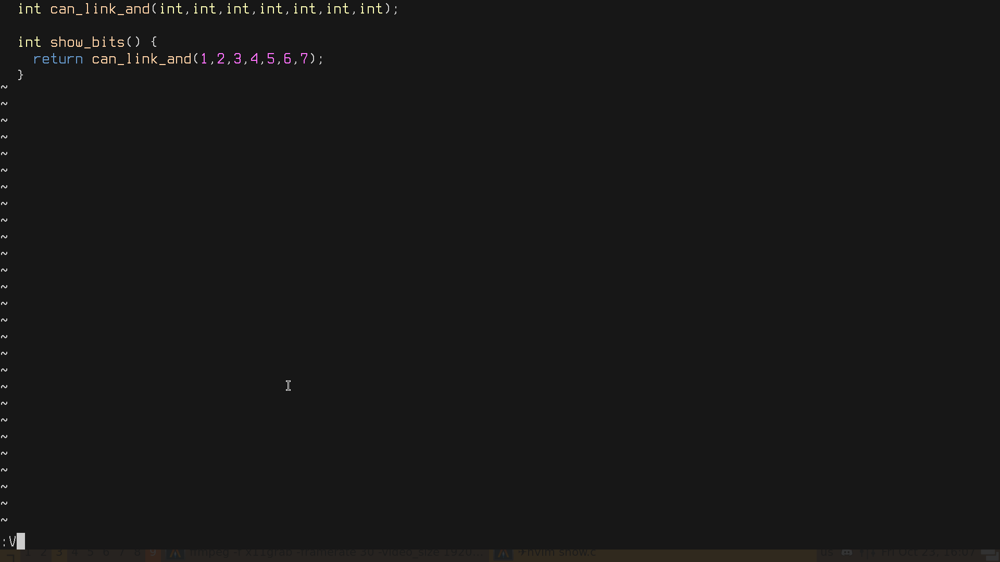

# vsplit_asm.nvim

Compile the current c/c++ file, link it into a flat image, and open the
disassembly in a vertical split, jumping to the function under your cursor.

Undefined externals (`printf`, `mmap`, ...) are given 0x10-byte stub slots by a
generated linker script, so any single object file links and `call` targets
show up as readable `<printf>` labels.



## Requirements

- Neovim >= 0.10
- `clang` and/or `gcc`, `nm`, `ld`, `objdump` on `$PATH`
- Optional `compile_flags.txt` next to the source file (one flag per line)

## Install (lazy.nvim)

```lua
{
    "Antares007/vsplit_asm.nvim",
    opts = {
        leader="<space>",
        keymaps = true,
        objdump_args = { "-m", "i386:x86-64", "-D", "-M", "intel" }
        },
}
```

## Usage

```vim
:VsplitAsm clang -O2
:VsplitAsm gcc -O3 -march=native
```

or from Lua: `require("vsplit_asm").run("clang", "-O2")`.

With `keymaps = true`:

| Keys          | Compiler | Flag |
|---------------|----------|------|
| `<leader>3`   | gcc      | -O3  |
| `<leader>2`   | gcc      | -O2  |
| `<leader>1`   | gcc      | -O1  |
| `<leader>0`   | gcc      | -O0  |
| `<leader>#`   | clang    | -O3  |
| `<leader>@`   | clang    | -O2  |
| `<leader>!`   | clang    | -O1  |
| `<leader>)`   | clang    | -O0  |

## Options (defaults)

```lua
require("vsplit_asm").setup({
  compile_flags_file = "compile_flags.txt",
  objdump_args = { "-m", "i386:x86-64", "-d", "-M", "intel" }, -- use "-D" to dump data too
  keymaps = false,
  leader = "<leader>",
})
```

Note: `compile_flags.txt` is a clang convention; clang-only flags will make
the `gcc` mappings fail (the compiler error is shown as a notification).
